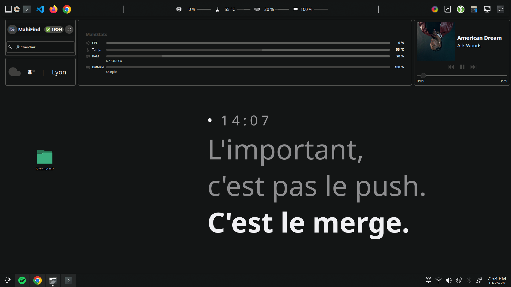
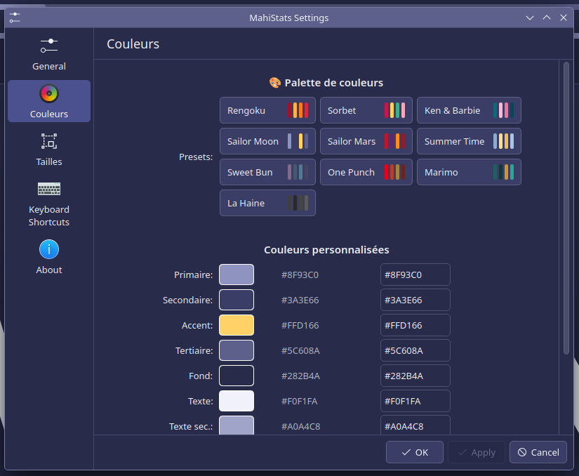
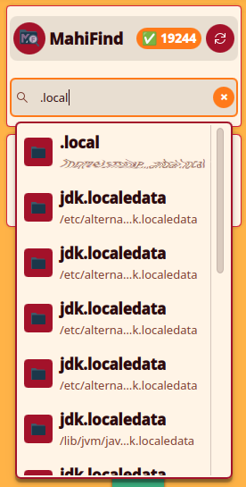
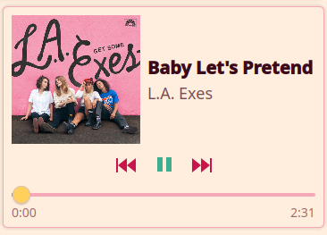
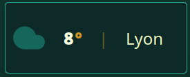
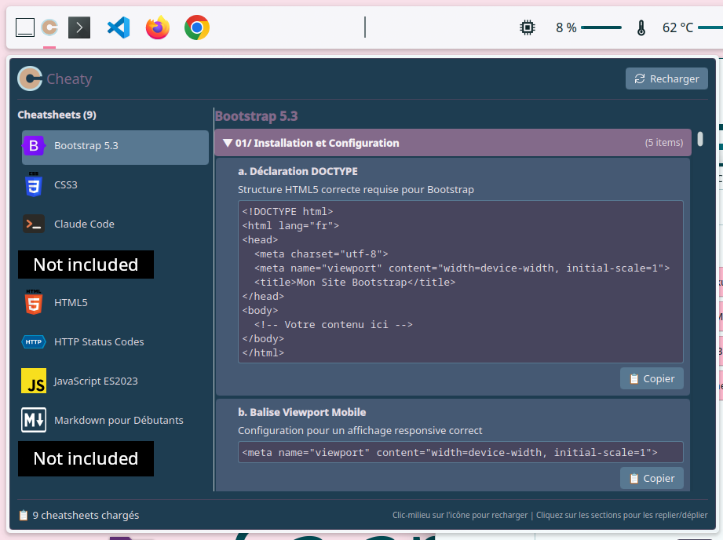

# MahiMahi plasmoids

[English](README.md) · **Français**

Une collection de plasmoids pour **KDE Plasma 6**, pensées comme un ensemble : elles parlent toutes la même
langue visuelle, et un seul clic suffit pour les habiller toutes de la même palette.



## L'idée : un standard commun

Chaque plasmoid suit le même standard, **MahiTheme** :

- **un onglet « Couleurs » identique partout**, avec 8 rôles de couleur (principale, secondaire, accent, fond,
  texte…) et les mêmes **10 palettes** prêtes à l'emploi : Rengoku, Sorbet, Ken & Barbie, Sailor Moon,
  Sailor Mars, Summer Time, Sweet Bun, One Punch, Marimo et La Haine ;
- **un onglet « Tailles » identique partout**, pour régler en pixels le titre, le texte, le petit texte, les icônes
  et l'arrondi des coins ;
- **MahiTheme**, une plasmoid et un script qui appliquent une palette à **tout KDE d'un coup** : schéma de couleurs
  des fenêtres, fond d'écran assorti, et toutes les plasmoids de la collection repeintes en direct.



## Les plasmoids

| | Plasmoid | À quoi elle sert |
|---|---|---|
|  | **[MahiFind](mahifind.MahiMahi99/)** | Mini-finder : tape quelques lettres pour retrouver un dossier et l'ouvrir |
|  | **[MahiFy](mahify.MahiMahi99/)** | Le titre en cours sur Spotify, avec pochette, progression et commandes de lecture |
|  | **[Weather Mahi](weathermahi.MahiMahi99/)** | Météo actuelle et prévisions de ta ville (OpenWeatherMap) |
|  | **[MahiStats](mahistats.MahiMahi99/)** | Processeur, température, mémoire et batterie : mini-barres dans le panneau, jauges ou barres sur le bureau |
|  | **[Cheaty](cheaty.MahiMahi99/)** | Antisèches (HTML, CSS, JavaScript, Bootstrap, Markdown, codes HTTP…) avec copie du code en un clic |
|  | **[MahiTheme](mahitheme.MahiMahi99/)** | Change de thème en un clic, pour tout KDE et toute la collection |

## Installation

Il faut KDE Plasma 6.

```bash
git clone https://github.com/k4hi99/mahimahi-plasmoids.git
cd mahimahi-plasmoids
```

### Une plasmoid

```bash
kpackagetool6 -t Plasma/Applet -i mahifind.MahiMahi99      # installer
kpackagetool6 -t Plasma/Applet -u mahifind.MahiMahi99      # mettre à jour
kpackagetool6 -t Plasma/Applet -r mahifind.MahiMahi99      # désinstaller
```

Elle apparaît ensuite dans *Ajouter des composants graphiques…* (après `systemctl --user restart plasma-plasmashell`
si elle n'y est pas tout de suite).

### Tout d'un coup

```bash
./install.sh
```

Installe toutes les plasmoids, leurs logos et le script `mahitheme`. Options : `--plasmoids` ou `--cli` pour une
partie seulement, `--link` pour des liens symboliques vers le dépôt (pratique pour modifier les plasmoids).

### Le script mahitheme (pour MahiTheme)

La plasmoid MahiTheme n'est qu'une interface : le travail est fait par le script `mahitheme`.

```bash
./install.sh --cli
mahitheme "Sweet Bun"          # appliquer une palette à tout KDE
mahitheme --rotation on        # changer de fond d'écran toutes les 15 minutes
```

Il installe `~/.local/bin/mahitheme`, les palettes dans `~/.config/mahitheme/themes.json` et un timer systemd
utilisateur. Les fonds d'écran se rangent par thème dans `~/Images/Themes/<Nom du thème>/`
(`~/Pictures/Themes/…` sur un système en anglais).
Tous les détails sont dans [mahitheme-cli/README.md](mahitheme-cli/README.md).

### Réglages particuliers

- **Weather Mahi** demande une clé API gratuite [OpenWeatherMap](https://openweathermap.org/api).
- **MahiFy** suit Spotify via MPRIS : l'application Spotify doit être lancée.
- **Cheaty** lit ses fiches depuis le disque, ce que Qt 6 n'autorise qu'avec `QML_XHR_ALLOW_FILE_READ=1` :
  ```bash
  mkdir -p ~/.config/environment.d
  echo 'QML_XHR_ALLOW_FILE_READ=1' > ~/.config/environment.d/cheaty.conf
  ```
  puis se déconnecter et se reconnecter.

## Transparence

Ces plasmoids ont été imaginées, conçues et testées par moi, et développées avec l'aide de **Claude**
(Anthropic), via [Claude Code](https://claude.com/claude-code) et [claude.ai](https://claude.ai).
Les idées, le design, les choix et les tests sont les miens ; Claude a écrit une grande partie du code
sous ma direction.

Le fichier [CLAUDE.md](CLAUDE.md) du dépôt montre comment nous avons travaillé ensemble : c'est le cahier des
charges que Claude Code lit avant chaque modification (standards des couleurs et des tailles, conventions,
checklist d'une nouvelle plasmoid).

## Crédits

**Cheaty** est une adaptation pour KDE Plasma 6 de l'applet Cinnamon
[Cheaty](https://cinnamon-spices.linuxmint.com/applets/view/285) (`cheaty@centurix`) de **centurix**,
publiée sous GPL-3.0 dans [cinnamon-spices-applets](https://github.com/linuxmint/cinnamon-spices-applets).
Les fiches **Markdown** et **HTTP Status Codes** viennent de l'original. L'interface a été réécrite en QML ;
les autres fiches, dont **Bootstrap 5.3** (l'original couvrait Twitter Bootstrap), sont nouvelles.

## Licence

[GPL-3.0](LICENSE) : **GPL-3.0-or-later** pour les plasmoids et le script `mahitheme`,
**GPL-3.0-only** pour Cheaty, comme l'applet d'origine.

Auteur : **MahiMahi99** · mahicala@gmail.com
