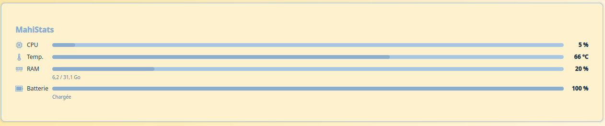

# MahiStats

[English](README.md) · **Français**

Charge du processeur, température, mémoire et batterie en un coup d'œil : mini-barres dans un panneau, jauges ou barres sur le bureau, avec un historique de 5 minutes.




## Utilisation

- Utilise les capteurs de Plasma (`org.kde.ksysguard`, installé avec le Moniteur système).
- Une valeur qui dépasse son seuil d'alerte passe en couleur accent.

## Réglages

Onglet **General** :

- **Vue complète** : jauges ou barres, historique affiché ou masqué
- **Vue compacte** : barres ou texte seul, RAM en % ou en Go
- **Seuils d'alerte** : température CPU, RAM, batterie faible

Onglets **Couleurs** et **Tailles** : le standard MahiTheme commun, avec ses 10 palettes, voir le [README général](../README.fr.md#lidée--un-standard-commun). Tailles en plus : jauges, graphique d'historique, barres, barres compactes.

## Installation

Depuis la racine du dépôt :

```bash
kpackagetool6 -t Plasma/Applet -i mahistats.MahiMahi99
```

---

Imaginée, conçue et testée par MahiMahi99, développée avec l'aide de Claude : voir [Transparence](../README.fr.md#transparence).
