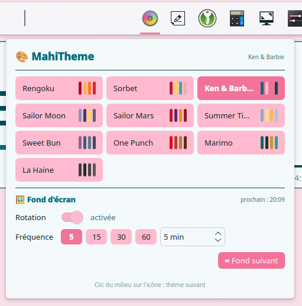

# MahiTheme

**English** · [Français](README.fr.md)

Switch themes in one click: KDE color scheme, a matching wallpaper and every plasmoid of the collection repainted live. It also controls wallpaper rotation.



## Usage

- Panel only. **Requires the `mahitheme` script**: `./install.sh --cli` from the repository root, see [mahitheme-cli](../mahitheme-cli/README.md).
- Middle-click the icon: next theme.
- Wallpapers: one folder per theme in `~/Pictures/Themes/<Theme name>/`.

## Settings

**Couleurs** (Colors) and **Tailles** (Sizes) tabs: the shared MahiTheme standard, 10 palettes included, see the [main README](../README.md#the-idea-one-shared-standard).

## Install

From the repository root:

```bash
kpackagetool6 -t Plasma/Applet -i mahitheme.MahiMahi99
```

---

Imagined, designed and tested by MahiMahi99, developed with the help of Claude: see [Transparency](../README.md#transparency).
